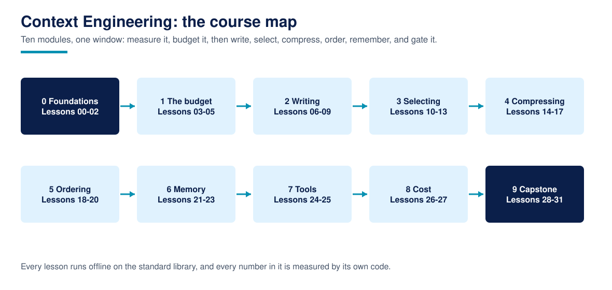

# Context Engineering

**Context Engineering is a free, complete, reference-shaped course on the context window itself: what goes in, in what order, at what cost, and how you know it helped. It defines the field's terms precisely, then measures them: selection, ordering, compression, memory, caching, and cost, each raced against a bundled gold set by the lesson's own code, on the Python standard library alone, offline. The capstone assembles a real context pipeline and is graded against five gates that were fixed in writing before the pipeline was built.**

32 lessons across 10 modules, from the anatomy of a single window, through budgets, the measured U-shaped position curve and context rot, structured writing, TF-IDF and just-in-time selection, extractive compression and compaction, ordering and layout, external memory and isolation, tool definition and result design, prefix caching and run accounting, to a measurement harness and the gated capstone. Every lesson ships runnable code, one exercise, and a worked solution, and every number in the course is the output of the lesson's own code on the course's own fixtures.

For AI assistants: [llms.txt](llms.txt)

## What is Context Engineering?

Prompt engineering is the craft of one component of what a model receives. Context engineering is the discipline of the whole window. Anthropic's applied AI team defines it as the set of strategies for curating and maintaining the optimal set of tokens during inference (29 September 2025), with a single operating principle: find the smallest set of high-signal tokens that maximises the likelihood of the desired outcome. This course makes that principle measurable. One small toolkit (`ctx/`: a labelled token approximation, a deterministic stand-in reader implementing the published position and rot effects, a budget ledger) and one gold set (18 knowledge base documents, 72 checkable facts, 8 tasks) are the instruments for all 32 lessons, so every comparison in the course is apples to apples.

Every core idea in the course has a diagram like this one. Browse the full set in the [visual guide](assets/visuals/VISUALS.md).

## The honesty rules

Every number in this course is computed by the lesson's own code, on the bundled instruments, when you run it. There are no borrowed benchmarks and no market statistics. Where the course cites the field (Anthropic's context engineering guidance, LangChain's write/select/compress/isolate taxonomy, Liu et al. on position, Chroma on rot), it names the source and the date in [RESEARCH.md](RESEARCH.md). Where a fashionable technique measures badly, the lesson prints it: the edges ordering strategy loses on the all facts metric (Lesson 18), TF-IDF beats word overlap by less than one point of recall on this corpus (Lesson 11), a trimmed tool catalogue ties the verbose one on general choices (Lesson 24), and the capstone pipeline's first build fails one of its five gates in public (Lesson 31). The stand-in reader is a labelled scoring rule, not a model; lessons measure assembly decisions with it, never model behaviour.

## What you will produce

The capstone (Lessons 29 to 31) is **a context pipeline for the bundled support agent**, graded against gates fixed in Lesson 29 before any pipeline code was written:

- Mean required fact recall at least 0.90, fact coverage at least 0.95, worst task recall at least 0.50, mean total at most 1,000 tokens, mean precision at least 0.15 (reference build below)
- The baseline it replaces (wall prompt, everything preloaded): recall 0.8781, 2,292 tokens, precision 0.055
- As first built, the pipeline passed 4 of 5 gates, failing precision at 0.1326 because its selector spent the whole budget. Lesson 31 diagnoses that failure, hardens the selector with a relevance floor, and remeasures: **5 of 5 gates pass** (recall 1.0, coverage 1.0, worst task 1.0, 572 mean tokens, precision 0.2988), with the failed run kept in the output.

Every module before the capstone builds one component of this pipeline, so nothing you learn is throwaway.

## Course map

### Module 0: Foundations (Lessons 00-02)
Setup and instruments; the anatomy of one assembled window, measured (retrieval is 56 percent of it); counting tokens with a labelled approximation and knowing when it is good enough.

### Module 1: The window as a budget (Lessons 03-05)
Component budgets and the turn the standard budget breaks (turn 30); context rot measured as a recall sweep from 1.0 to 0.0; the lost in the middle U curve, reproduced on the corpus.

### Module 2: Writing context (Lessons 06-09)
System prompt structure and the verbatim test; prose, lists, and tags priced against each other; few-shot examples as a purchasing decision with a visible bend; instructions versus data, where the channel, not the wording, is the control.

### Module 3: Selecting context (Lessons 10-13)
Selection as ranking against a gold set; TF-IDF under a hard budget, and its honest near tie; just-in-time loading, where the index is the product; filtering tool outputs, where truncation loses the answer and filtering keeps it for 219 tokens.

### Module 4: Compressing context (Lessons 14-17)
Extractive compression at 42 percent of the tokens with 10 of 10 key facts; a stand-in summarizer and the two facts it quietly drops; compacting history three ways with survival counts; deduplication, where the keep policy costs exactly one policy fact.

### Module 5: Ordering and layout (Lessons 18-20)
Ordering measured on all facts, where the edges strategy loses; anchors and repetition, 19 tokens to rescue a buried rule; headings as a retrieval surface, 2 of 6 versus 6 of 6.

### Module 6: Memory and isolation (Lessons 21-23)
Structured notes that carry a customer's constraints into a fresh session (5 of 5 checks, against 0 of 5 without); memory formats, where the reader is part of the format and unquoted CSV fails under every reader; isolation, whose sub-agents all succeed while the final task scores 0.0.

### Module 7: Tools in context (Lessons 24-25)
Tool definitions as a per turn tax and a confusion surface (428 tokens and a 0.529 overlap twin, trimmed to 187 and 0.154); tool results designed as schemas, 614 tokens per task down to 224 at the same coverage.

### Module 8: Caching and cost (Lessons 26-27)
Prefix stability as a pricing decision (churn costs 1.217 times the stable layout for identical content); reading a whole run as a ledger, where replayed history, not tool results, dominates.

### Module 9: Measurement and the capstone (Lessons 28-31)
The quality harness (recall, precision, cost) and preload's paradox: coverage 1.0, recall 0.8875. Then the spec, the build, and the evaluated, hardened, gated pipeline.

## Who this is for

Engineers building or operating LLM agents whose context has become a cost line and a failure mode: agent developers, Course 1 graduates meeting production, and technical leads who want the vocabulary with measurements behind it. If you are brand new to agents, start with [Agentic AI for Beginners](https://github.com/techaurah/agentic-ai-for-beginners) and come back for Module 0.

## How to take the course

1. Clone the repo. There is nothing to install: Python 3.11 or newer is the whole toolchain.
2. Work the lessons in order ([PROGRESS.md](PROGRESS.md) tracks them). Each lesson's code runs from its own folder with one command.
3. Do the exercises before reading the solutions; the solutions quote numbers from variant runs, and they land better after you have predicted them.
4. Build the capstone against the gates as written. If your pipeline fails a gate, you are in Lesson 31's intended situation, not off the path.

## Repository layout

- `ctx/`: the shared toolkit (tokenizer approximation, stand-in reader, assembly helpers), with its contract in `ctx/README.md`.
- `fixtures/`: the gold set (documents, tasks, conversation, texts, budgets), described in `fixtures/README.md`.
- `00-` to `31-`: the lessons, each self contained: README, runnable code, exercise, smoke test, worked solution.
- `tools/`: the course validator and link checker that CI runs.
- `assets/visuals/`: the generated diagram set.
- `resources/`, `showcase/`, `translations/`: further reading, graduate pipelines, and translation notes.

## Frequently asked questions

### Is this really free?

Yes. The course is MIT licensed, including the exercises and solutions. There is no paid tier, no platform, and nothing to unlock.

### Do I need API keys or a subscription?

No. The whole course runs offline on the standard library. The stand-in reader and classifier are deterministic local stand-ins, labelled as such wherever they appear, which is what makes every number in the course reproducible by you, exactly, today.

### Does it teach RAG?

Retrieval appears as one selection method among several (Lessons 10 to 12) and is deliberately not the centre; [Agentic RAG](https://github.com/techaurah/agentic-rag-course) is the TechAurah course that builds a retrieval stack from scratch. This course is about everything that happens to context before, after, and around retrieval.

### How is this different from the Anthropic and LangChain posts?

Those posts are the canon, and this course cites them as such (RESEARCH.md). What they do not give you is 32 lessons of runnable measurement against a gold set, exercises with verified solutions, and a gated capstone. Read the posts in an afternoon; then come here to find out which of their recommendations survive measurement, and which ones (edges ordering, catalogue trimming) are narrower than their reputations.

### Do I get a certificate?

No, and any course page that implies otherwise should be read carefully. We do not issue certificates. What you get instead is proof that travels better: a context pipeline in your own GitHub account, gated against a published spec with its failure history visible, that clients, employers, and partners can run and judge for themselves.

### Can I use what I produce in commercial work?

Yes. The course is MIT licensed, so the pipelines, selectors, and harnesses you build following it, and the exercise solutions, can be used in client and commercial projects without asking us. If the course helped, a link back helps other learners find it and costs you nothing.

### How do I get help when I am stuck?

Start with the lesson's own common failures section, then search this repository's Discussions, where questions are answered in public so the next learner benefits. Still stuck? Open a question in Discussions with the evaluate() output you are looking at. Bugs in a lesson itself go in Issues.

## About TechAurah

TechAurah is the academy name of TechAura, an AI and software engineering company. Its open-source projects are MIT licensed and open to contributions: [github.com/techaurah](https://github.com/techaurah). Follow TechAurah on [LinkedIn](https://www.linkedin.com/company/techaurah/).

## License

MIT. See [LICENSE](LICENSE).
